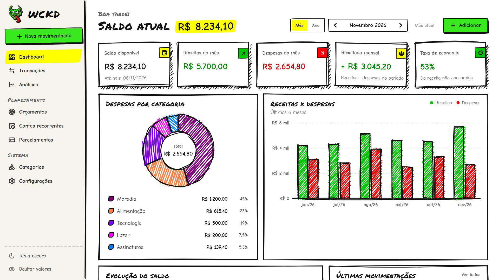
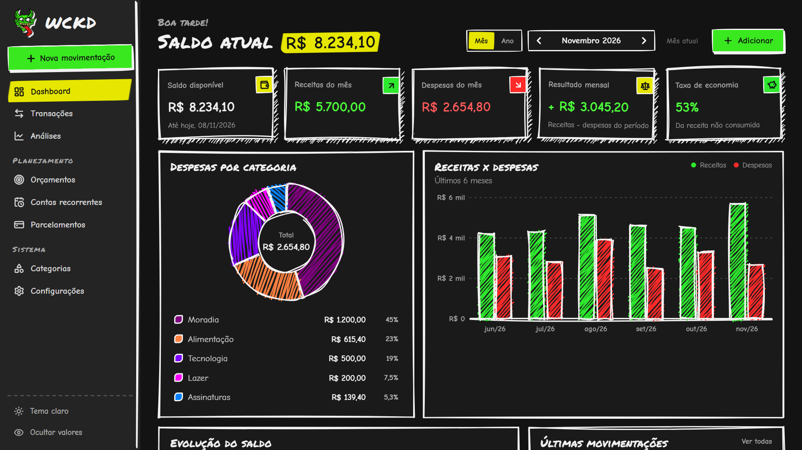
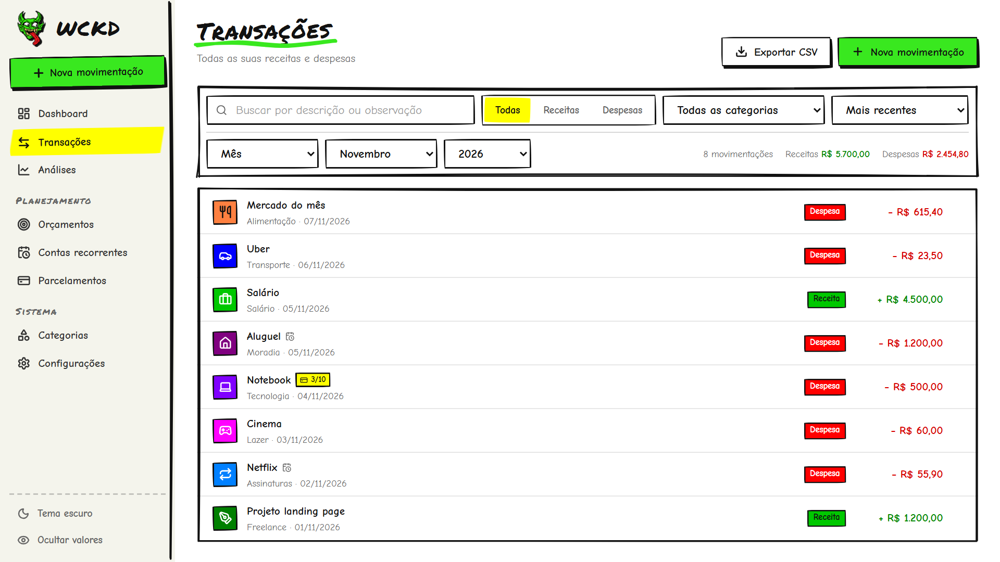
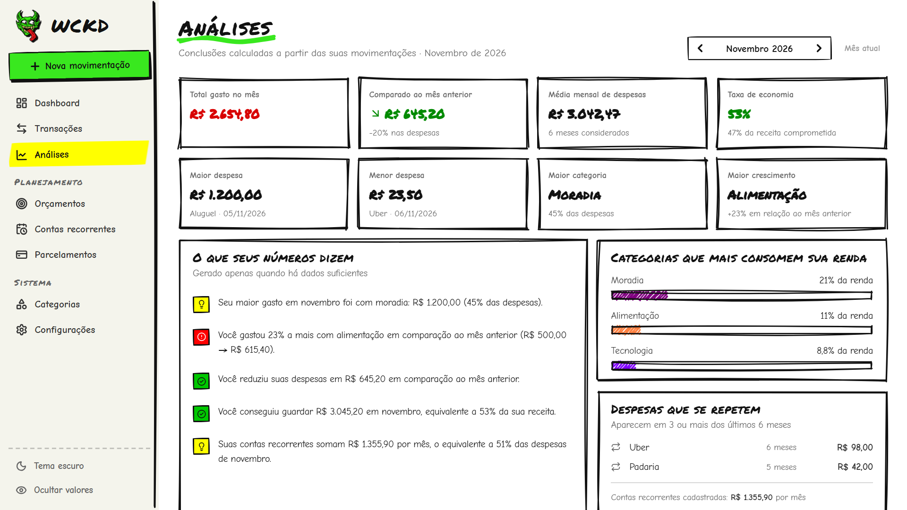
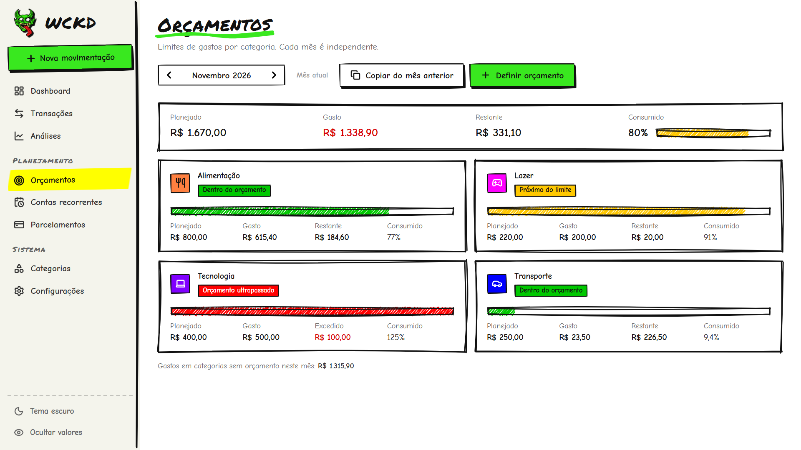
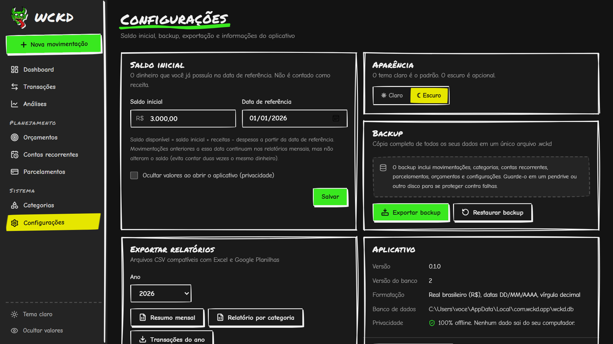

<div align="center">


# WCKD

**Gerenciador financeiro pessoal para Windows: rápido, leve, 100% offline e com cara de rabisco no Paint.**

[](https://github.com/asafeareas/WCKD/releases/latest)


[](LICENSE)

[**⬇ Baixar o instalador**](https://github.com/asafeareas/WCKD/releases/latest) · [Funcionalidades](#-funcionalidades) · [Instalação](#-instalação) · [Desenvolvimento](#-desenvolvimento)

<br />



</div>

---

O WCKD é o seu centro de controle financeiro pessoal. Você registra uma compra em segundos e vê na hora como ela mexeu
nas suas finanças: saldo, gastos por categoria, evolução mês a mês e quanto está conseguindo guardar.

- 🔒 **Privado:** os dados ficam só no seu computador. O app não tem login, nuvem, telemetria nem analytics.
- ⚡ **Leve:** o instalador tem ~2,5 MB, a janela abre em ~0,3 s e o consumo de CPU parado é praticamente zero.
- 🧮 **Preciso:** dinheiro em centavos inteiros, sem erro de arredondamento. Os cálculos são feitos em Rust e cobertos por testes.
- 🖍️ **Diferente:** tudo rabiscado à mão, na paleta saturada do MS Paint. Tem tema claro (padrão) e escuro.

## 📸 Prints

| Dashboard (tema escuro) | Transações |
|---|---|
|  |  |
| **Análises automáticas** | **Orçamentos** |
|  |  |
| **Configurações e backup** | |
|  | |

> Os prints usam dados de demonstração.

## ✨ Funcionalidades

- **Dashboard:**
  - Saldo disponível, receitas, despesas, resultado e taxa de economia, por mês ou por ano.
  - Gráficos: pizza por categoria, barras de receitas × despesas e evolução do saldo.
- **Lançamento rápido:** `Ctrl+N` em qualquer tela. Basta descrição, valor, categoria e data.
- **Transações:** busca, filtros (tipo, categoria, mês, ano, período livre), ordenação, edição, exclusão com confirmação e exportação CSV.
- **Categorias:** separadas por receita e despesa, com cor e ícone. Para excluir uma categoria em uso, o app reclassifica os registros antes, sem perder nada.
- **Análises:** conclusões como *"Você gastou 23% a mais com alimentação…"*, que só aparecem quando há dados suficientes. Comparação histórica de 3, 6 ou 12 meses.
- **Contas recorrentes:** mostram vencimentos, atrasos e histórico. Uma conta só vira despesa quando você marca como paga, e o app impede pagar a mesma conta duas vezes.
- **Parcelamentos:** cada parcela entra no mês certo e a soma das parcelas é sempre exatamente o total.
- **Orçamentos:** limite por categoria e mês, com aviso de "dentro do orçamento", "próximo do limite" ou "ultrapassado".
- **Backup e restauração:** o app valida a integridade do arquivo e salva uma cópia de segurança antes de restaurar.
- **Relatórios CSV:** resumo mensal e relatório por categoria, prontos para o Excel em português.
- **Ocultar valores:** útil para compartilhar a tela.

## 📦 Instalação

### Opção 1: baixar o instalador

1. Baixe o **`WCKD_x.y.z_x64-setup.exe`** em [**Releases**](https://github.com/asafeareas/WCKD/releases/latest).
2. Execute o instalador. Ele não pede senha de administrador.
3. Abra o **WCKD** pelo Menu Iniciar.

### Opção 2: pelo PowerShell

```powershell
Invoke-WebRequest "https://github.com/asafeareas/WCKD/releases/latest/download/WCKD_0.1.0_x64-setup.exe" -OutFile "$env:TEMP\WCKD-setup.exe"; Start-Process "$env:TEMP\WCKD-setup.exe"
```

Para uma instalação silenciosa, sem nenhuma tela, adicione `-ArgumentList "/S"` ao `Start-Process`.

> [!NOTE]
> O instalador ainda não tem assinatura digital. Se o Windows SmartScreen mostrar um aviso, clique em
> **Mais informações → Executar assim mesmo**.

**Requisitos:** Windows 10 ou 11 (64 bits). O WebView2 já vem no Windows 11. No Windows 10, o instalador baixa o WebView2 automaticamente se ele estiver faltando.

### Onde ficam meus dados?

`%LOCALAPPDATA%\com.wckd.app\wckd.db`. O caminho completo aparece em *Configurações → Aplicativo*.

Essa pasta fica fora da instalação. Atualizar ou reinstalar o WCKD **não apaga** seus dados.
Para se proteger contra falhas de disco, use *Configurações → Backup → Exportar backup*.

## 🛠 Desenvolvimento

**Stack:** Rust · Tauri 2 · SQLite (rusqlite) · React 19 · TypeScript · Vite · Tailwind CSS 4 · Rough.js · Lucide.

### Pré-requisitos

```powershell
winget install Rustlang.Rustup
winget install Microsoft.VisualStudio.2022.BuildTools --override "--wait --passive --add Microsoft.VisualStudio.Workload.VCTools --includeRecommended"
winget install OpenJS.NodeJS.LTS
```

### Rodar a partir do código

```bash
git clone https://github.com/asafeareas/WCKD.git
cd WCKD
npm install
npm run tauri dev
```

### Testes

```bash
npm test                     # frontend (Vitest)
npm run typecheck            # TypeScript
cd src-tauri && cargo test   # backend: regras de negócio, banco, backup
```

### Gerar o instalador

```bash
npm run tauri build
```

Os arquivos gerados ficam em:
- Instalador: `src-tauri/target/release/bundle/nsis/WCKD_<versão>_x64-setup.exe`
- Executável avulso: `src-tauri/target/release/wckd.exe`

Para lançar uma nova versão:

1. Atualize o número da versão em `package.json`, `src-tauri/Cargo.toml` e `src-tauri/tauri.conf.json`, sempre igual nos três.
2. Se o banco mudou, crie uma nova migração. O passo a passo está em [docs/architecture.md](docs/architecture.md#como-adicionar-uma-migração).
3. Gere o build e publique o `-setup.exe` numa nova release.

<details>
<summary><b>Trocar o ícone do app</b></summary>

A imagem original do ícone é `src-tauri/app-icon.png` (1024×1024, fundo transparente). O logo usado dentro do app fica em `src/assets/logo.png`.

```bash
npx tauri icon src-tauri/app-icon.png -o src-tauri/icons
cd src-tauri && cargo clean --release -p wckd
```

O `cargo clean` é necessário porque o ícone fica embutido no `.exe` e o Cargo não percebe essa mudança sozinho.
</details>

<details>
<summary><b>Gerar os prints do README</b></summary>

Rode `npm run dev` e abra `http://localhost:1420/?demo&page=dashboard&theme=dark`.

O modo `?demo` usa dados fictícios de `src/dev/demo.ts`. Ele só existe no modo de desenvolvimento e nunca entra no executável.
</details>

### Estrutura

```
src/                     frontend React (interface)
  pages/                 telas
  components/            UI rabiscada, gráficos (Rough.js), modais
  lib/                   api tipada, formatação, estado, validação
src-tauri/
  src/commands.rs        commands do Tauri (camada fina)
  src/services/          regras de negócio + testes
  src/db.rs              conexão e migrações
  migrations/            schema SQL versionado
docs/                    arquitetura, regras de negócio, decisões
```

## 📚 Documentação

- [Regras de negócio](docs/business-rules.md): como saldo, parcelas, recorrências e análises são calculados.
- [Arquitetura](docs/architecture.md): decisões técnicas, banco de dados e backup.
- [Histórico de decisões](docs/decisions.md)

## 📄 Licença

Distribuído sob a [licença MIT](LICENSE). Você pode usar, copiar, modificar e distribuir à vontade, desde que mantenha o aviso de copyright.
